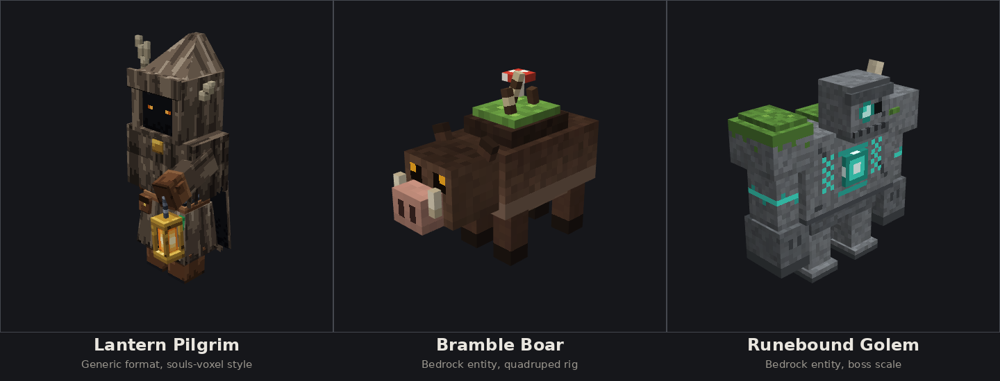
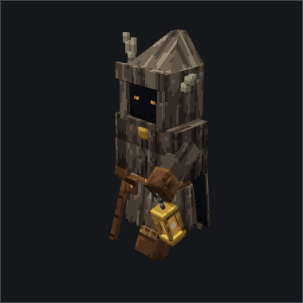
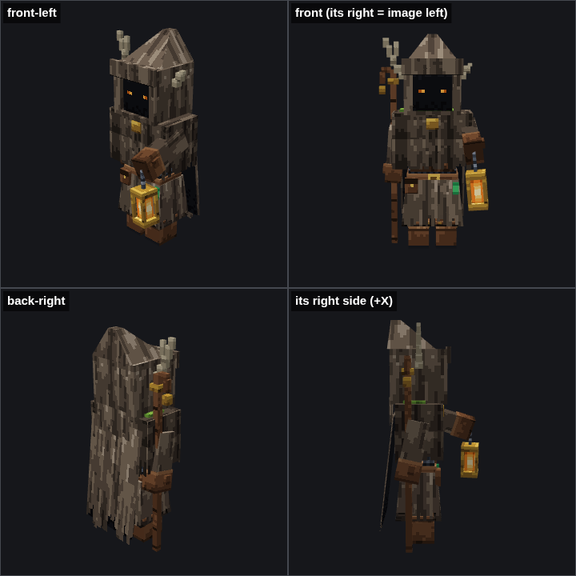
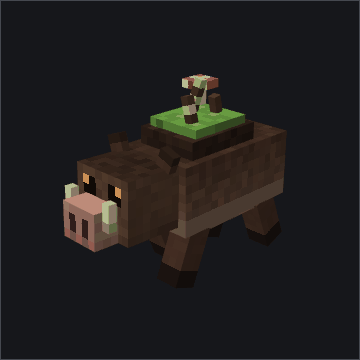
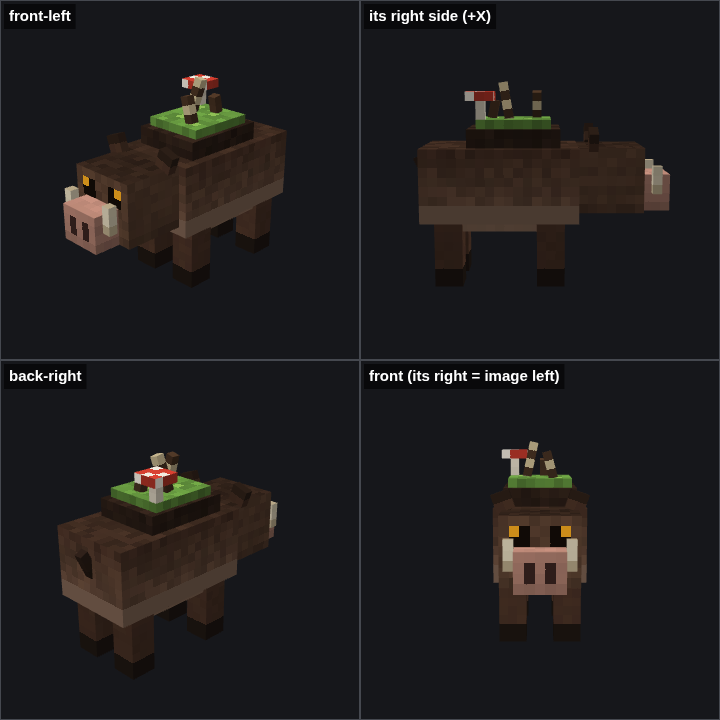
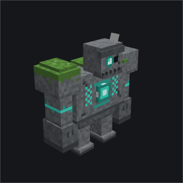
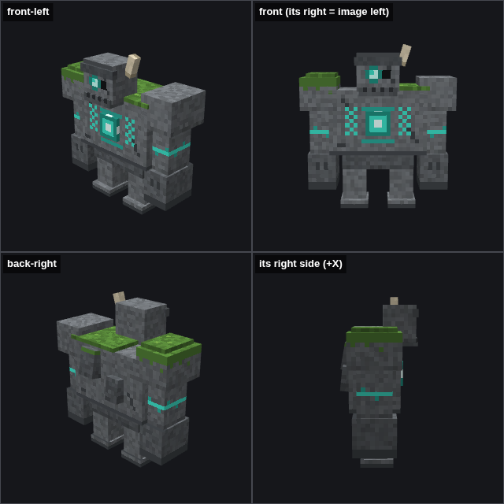

# Blockbench MCP Plus



An MCP server inside [Blockbench](https://www.blockbench.net/) that lets AI agents build, texture, rig and animate models in the live editor. It extends [jasonjgardner/blockbench-mcp-plugin](https://github.com/jasonjgardner/blockbench-mcp-plugin) with **workflow tools**: higher-level operations that replace long chains of low-level calls and the coordinate math agents tend to get wrong.

Everything in the gallery below was built, painted, rigged, animated and rendered through these tools.

## What this adds

| Tool | What it does |
|------|--------------|
| `build_rig` | Creates a whole bone hierarchy with its cubes in one undoable edit. On box UV projects it packs every new cube's UV net without overlaps (avoiding existing nets) and grows the project UV size when needed. |
| `paint_cube_faces` | Paints faces in face-local pixels, where (0,0) is the face's top-left as seen on the model, whatever its texture position, mirroring or rotation. Ops: `base` (fill with directional shading and noise), `fill`, `rect`, `pixels`, `pattern` (ASCII pixel art with a palette), `gradient`, `border`, `noise`, `shade`, `erase`. Targets single cubes or whole groups. |
| `capture_views` | Renders several labelled angles into one composite image through a temporary offscreen view, without moving your camera. Pass `animation` and `time` to render a pose; framing stays on the rest pose so frame sequences line up for GIFs. |
| `generate_animation` | Generates idle, walk, run, attack, hurt, death and jump cycles. Bone roles (head, body, arms, legs, tail, wings) come from bone names, with X/Z position as a fallback. Four-legged rigs trot when walking and bound when running, and armless creatures attack with a head snap. Any role can be overridden. |
| `audit_model` | Reports box UV nets outside the UV canvas or overlapping, texture/UV size mismatches, unpainted faces, cubes outside bones, duplicate bone names, empty groups and left/right names that contradict their position. |

It also fixes two bugs from the original:

- `delete_offscreen_view` threw `onContextMenu is not defined` on Blockbench 5.2 and leaked the view's input listeners.
- `create_texture` did not adopt the first texture's size as the project UV size on box UV formats, as Blockbench's own import does. Box UV nets then addressed a 16x16 area of a larger texture.

In Blockbench editor space a model faces north (-Z), so its own right side is +X. The workflow tools follow that convention.

## Gallery

### Lantern Pilgrim



A hooded wanderer with one broken antler, holding a lantern and a staff, in a "Minecraft meets Soulsborne" voxel style. It uses the Generic format with 57 elements and ragged see-through hems on a 512px atlas. The geometry and texture were scripted through `risky_eval`. The animations come from `generate_animation` (idle, walk, hurt), and `audit_model` checked the result.

[`examples/lantern_pilgrim.bbmodel`](examples/lantern_pilgrim.bbmodel)

<br clear="right">



### Bramble Boar



A Bedrock entity with a quadruped rig, carrying a mossy back, brambles and a mushroom. The whole model took one `build_rig` call (20 cubes, auto-packed into a 64x128 box UV canvas) and one `paint_cube_faces` call. The eyes and nostrils are ASCII patterns. `generate_animation` detected the four legs and produced a trot (walk), a bound (run), an idle and a head-snap attack.

[`examples/bramble_boar.bbmodel`](examples/bramble_boar.bbmodel)

<br clear="right">



### Runebound Golem



A boss-scale Bedrock entity: moss-covered stone with glowing runes, a crystal core and a single eye. It uses the same pipeline at a bigger size, with 21 cubes on a 128x128 canvas. Its five animations are idle, walk, an overhead slam, hurt and death. While it was being built, `audit_model` caught a hierarchy bug in an early version of `build_rig` that left most faces unpainted.

[`examples/runebound_golem.bbmodel`](examples/runebound_golem.bbmodel)

<br clear="right">



## Plugin Installation

Open the desktop version of Blockbench, go to **File > Plugins**, click **Load Plugin from URL** and paste this URL:

**[https://itsashn.github.io/blockbench-mcp-plus/mcp.js](https://itsashn.github.io/blockbench-mcp-plus/mcp.js)**

You can also save that `mcp.js` file, or build it yourself with `bun install && bun run build` (output in `dist/mcp.js`), and use **Load Plugin from File**. The plugin keeps the original's id (`mcp`), so it replaces jasonjgardner's plugin rather than running beside it. Uninstall that one first.

Then connect your client, for example Claude Code:

```bash
claude mcp add blockbench --transport http http://localhost:3000/bb-mcp
```

## Model Context Protocol Servers

This repository contains two MCP server options.

### Headless `.bbmodel` (stdio)

A separate stdio MCP server edits, validates, converts and renders `.bbmodel` files directly, without Blockbench running. Each agent can start its own process, so several can work in parallel while you keep using the editor. Run it straight from GitHub:

```bash
npx -y github:ItsAshn/blockbench-mcp-plus --root ./models
```

See [headless/README.md](headless/README.md) for client configuration, the tool list and limits.

### Blockbench Desktop Plugin (HTTP)

Configure the MCP server under Blockbench settings: **Settings** > **General** > **MCP Server Port** and **MCP Server Endpoint**.

> The following installation settings examples use the default values of `:3000/bb-mcp`

## Installation

The examples below configure the desktop plugin over **HTTP** and the headless server over **stdio**. You can use either server or both. HTTP requires Blockbench running with the plugin installed; stdio requires Node.js with npm and starts its own server process.

For headless examples, replace `/path/to/models` with an absolute path to your model directory (for example, `C:/Users/you/models` on Windows). `--root` is required and limits file access to that directory. 

> On Windows, clients that cannot launch `npx` directly should use `"command": "cmd"` and prepend `"/c", "npx"` to `args`, as shown for Claude Desktop.

<details>
<summary>General</summary>

```bash
# Desktop plugin (HTTP)
npx mcp-add --type http --url "http://localhost:3000/bb-mcp" --scope project

# Headless (stdio)
npx mcp-add --name bbmodel --type stdio --command "npx -y github:ItsAshn/blockbench-mcp-plus --root /path/to/models" --scope project
```
</details>

<details>
<summary>VS Code</summary>

**`.vscode/mcp.json`**

```json
{
  "servers": {
    "blockbench": {
      "url": "http://localhost:3000/bb-mcp",
      "type": "http"
    },
    "bbmodel": {
      "type": "stdio",
      "command": "npx",
      "args": [
        "-y",
        "github:ItsAshn/blockbench-mcp-plus",
        "--root",
        "${input:rootDir}"
      ]
    }
  },
  "inputs": [
    {
      "id": "rootDir",
      "type": "promptString",
      "description": "Root directory for headless Blockbench models",
      "default": "${workspaceFolder}/models"
    }
  ]
}
```
</details>

<details>
<summary>Claude Desktop</summary>

**`claude_desktop_config.json`** (macOS/Linux)

```json
{
  "mcpServers": {
    "blockbench": {
      "command": "npx",
      "args": ["-y", "mcp-remote", "http://localhost:3000/bb-mcp"]
    },
    "bbmodel": {
      "command": "npx",
      "args": ["-y", "github:ItsAshn/blockbench-mcp-plus", "--root", "/path/to/models"]
    }
  }
}
```

**`claude_desktop_config.json`** (Windows)
```json
{
  "mcpServers": {
    "blockbench": {
      "command": "cmd",
      "args": ["/c", "npx", "-y", "mcp-remote", "http://localhost:3000/bb-mcp"]
    },
    "bbmodel": {
      "command": "cmd",
      "args": ["/c", "npx", "-y", "github:ItsAshn/blockbench-mcp-plus", "--root", "C:/Users/you/models"]
    }
  }
}
```
</details>

<details>
<summary>Claude Code</summary>

```bash
# Desktop plugin (HTTP)
claude mcp add blockbench --transport http http://localhost:3000/bb-mcp

# Headless (stdio)
claude mcp add bbmodel --transport stdio -- npx -y github:ItsAshn/blockbench-mcp-plus --root /path/to/models
```
</details>

<details>
<summary>Codex</summary>

```bash
codex plugin marketplace add jasonjgardner/blockbench-mcp-project --ref codex
codex plugin add blockbench-mcp@blockbench-mcp-project
```

Or register the servers directly:

```bash
# Desktop plugin (HTTP)
codex mcp add blockbench --url http://localhost:3000/bb-mcp

# Headless (stdio)
codex mcp add bbmodel -- npx -y github:ItsAshn/blockbench-mcp-plus --root /path/to/models
```
</details>

<details>
<summary><a href="https://antigravity.google/docs/mcp#connecting-custom-mcp-servers">Antigravity</a></summary>

```json
{
  "mcpServers": {
    "blockbench": {
      "serverUrl": "http://localhost:3000/bb-mcp"
    },
    "bbmodel": {
      "command": "npx",
      "args": ["-y", "github:ItsAshn/blockbench-mcp-plus", "--root", "/path/to/models"]
    }
  }
}
```
</details>

<details>
<summary>Cline</summary>


**`cline_mcp_settings.json`**

```json
{
  "mcpServers": {
    "blockbench": {
      "url": "http://localhost:3000/bb-mcp",
      "type": "streamableHttp",
      "disabled": false,
      "autoApprove": []
    },
    "bbmodel": {
      "type": "stdio",
      "command": "npx",
      "args": ["-y", "github:ItsAshn/blockbench-mcp-plus", "--root", "/path/to/models"],
      "disabled": false,
      "autoApprove": []
    }
  }
}
```
</details>

<details>
<summary>Ollama</summary>

```bash
# Desktop plugin (HTTP)
uvx ollmcp -u http://localhost:3000/bb-mcp

# Headless (stdio): register, then start the client
uvx ollmcp mcp add bbmodel -- npx -y github:ItsAshn/blockbench-mcp-plus --root /path/to/models
uvx ollmcp
```

Recommended: [jonigl/mcp-client-for-ollama](https://github.com/jonigl/mcp-client-for-ollama)
</details>

<details>
<summary>OpenCode</summary>

```bash
opencode mcp add
```

Choose a remote server for the desktop HTTP URL, or a local server for the headless command. You can also configure both in **`opencode.json`**:

```json
{
  "$schema": "https://opencode.ai/config.json",
  "mcp": {
    "blockbench": {
      "type": "remote",
      "url": "http://localhost:3000/bb-mcp",
      "enabled": true
    },
    "bbmodel": {
      "type": "local",
      "command": ["npx", "-y", "github:ItsAshn/blockbench-mcp-plus", "--root", "/path/to/models"],
      "enabled": true
    }
  }
}
```

See the [OpenCode MCP configuration reference](https://opencode.ai/docs/mcp-servers/) for local and remote server options.


</details>


## Usage

[See sample project](https://github.com/jasonjgardner/blockbench-mcp-project) for prompt examples.

### [Skills](https://skills.sh/jasonjgardner/blockbench-mcp-project)

Use Agent Skills to orchestrate tool usage.

## Extending from another plugin

Other Blockbench plugins can register their own MCP tools through a global `MCP_QUEUE`, without bundling or importing this plugin. See [docs/plugin.md](docs/plugin.md) for the API and an example.

> [!NOTE]
> Plugins in the official Blockbench plugin repository are not allowed to use AI features, so a plugin that registers MCP tools has to be distributed some other way.

## Plugin Development

See [CONTRIBUTING.md](CONTRIBUTING.md) for detailed instructions on setting up the development environment and how to add new tools, resources, and prompts.

## Security

The desktop plugin's HTTP server listens on this computer only (`127.0.0.1` and `::1`) by default, so `http://localhost:3000/bb-mcp` works whether a client resolves `localhost` to IPv4 or IPv6. Requests with a non-loopback `Origin` or `Host` header get `403 Forbidden`, which keeps web pages, including DNS rebinding attacks, from driving Blockbench through your browser.

To accept connections from other computers (for example a client inside WSL2 without mirrored networking, a VM, or another machine), set **Settings** > **General** > **MCP Server Host** to `0.0.0.0` or `::` and reload the plugin. In that mode the `Host` header is no longer checked, since other computers reach the server by its address, but requests with a non-loopback `Origin` header are still refused. The server has no authentication: anyone who can reach the port can call every tool, including `risky_eval`. Only do this on a trusted network and keep your firewall rules restrictive.

`risky_eval` runs any JavaScript a client sends. To turn it off, clear **Settings** > **General** > **Enable risky_eval**: connected clients stop seeing the tool and its calls are refused.

## Credits and license

Built on [jasonjgardner/blockbench-mcp-plugin](https://github.com/jasonjgardner/blockbench-mcp-plugin) by Jason J. Gardner and its contributors. Licensed under the GNU GPL v3.0, as the original is (see [LICENSE](LICENSE)). The workflow tools take ideas from [sosadly/blockbench-mcp](https://github.com/sosadly/blockbench-mcp) (MIT). No code was copied from it.
